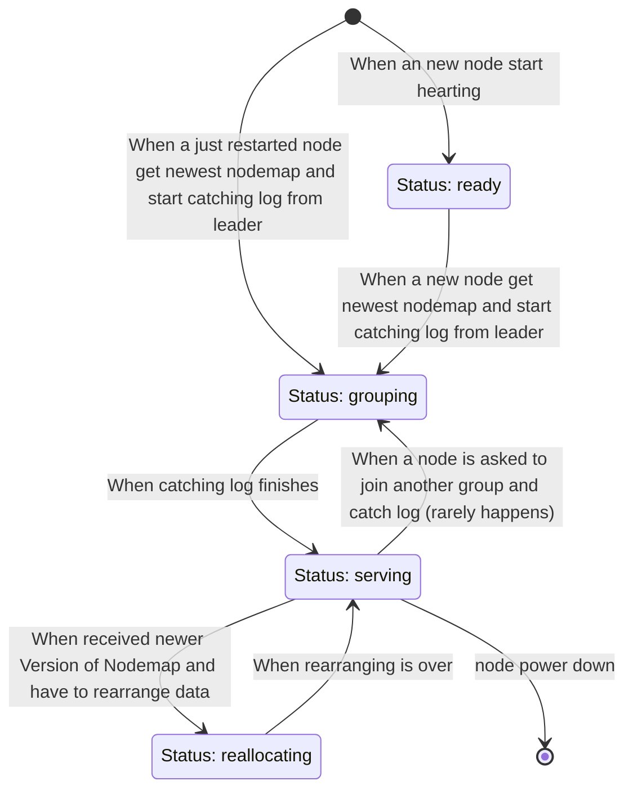

# Monitor
The Monitor component embodies the core logic of the Index Layer described in the main project README.
Monitor is the brain of Index Layer.
It monitors Storage Layer status and performs recovery. e.g.
- Monitor Storage Nodes cluster scales up/down
- Monitor health of Storage Nodes
- Provide Storage Nodes' information to other layers
- Detect and recover data corruptions (Hard disk sometimes corrupts files)
- Detect and recover Node Failures

## Endpoints
- `/heartbeat` StorageNode request this Endpoint to update status and report health.
e.g. (example contains comments which are not supported by JSON. Please delete these comments when trying)
```json5
{
  "Status": "ready", // Node status: ready, reallocating, grouping, serving
  "NodeId": "1",
  "Role": "Leader",
  "Addr": "127.0.0.1:12345",
  "Group": "0",
  "NodemapVersion": 1, // The newest received nodemap version
}
```
```json5
//response:
{
  "NodemapVersion": 2, // Tell StorageNode the newest Nodemap version
}
```
- `/nodemap?NodeId=` Get nodemap. e.g.
```json5
//response:
{
  "Nodemap": {
    "0": {
      "Range": ["0","7FFFFFFFFFFFF..."],
      "NodeAddrs": ["127.0.0.1:12345"]
    },
    "1": {
      "Range": ["8FFFFFFFFFF...","FFFFFFFFFFFF.."],
      "NodeAddrs": ["127.0.0.1:12346"]
    }, //Could have more...
  }
}
```


Everytime nodemap updating, there is only 1 grouping update or only 1 reallocating update.

### Grouping Algorithm (Node Integration)

When new nodes are added or existing nodes rejoin the cluster, they undergo a grouping process:

1.  **Receive Node Map:** The Monitor provides the node with the latest version of the node map (data distribution).
2.  **Identify Group:** The node determines the storage group it belongs to based on the received node map.
3.  **Leader Election (for new groups):** If the node is part of a newly formed group, the nodes in this group elect a leader (typically the first node in the group list for the initial term).
4.  **Log Synchronization:** The node contacts the leader of its group to synchronize its local log, catching up on any writes that occurred while it was disconnected or initializing.
5.  **Ready State:** Once the log is synchronized, the node transitions its status to `ready` (or `serving` if it has caught up and is fully operational).

### Reallocating Algorithm (Data Re-balancing)

Data reallocating (re-balancing) occurs when the node map changes, typically due to cluster scaling or to optimize data distribution. This process usually involves two neighboring segments (data ranges): one shrinking (source) and one growing (destination).

1.  **Node Map Update:** Both the source and destination segment nodes receive the newest node map from the Monitor, indicating the new data boundaries.
2.  **Write Forwarding (Source Segment):** The source segment nodes begin to route writes for data that now falls into the shrinking portion of its range to the destination segment. The destination segment logs these incoming writes.
3.  **Data Migration:** The destination segment nodes pull the existing data files/slices that belong to their new, expanded range from the source segment nodes.
4.  **Log Replay (Destination Segment):** After migrating the bulk data, the destination segment nodes replay the logged writes (from step 2) that occurred during the migration to ensure data consistency.
5.  **Completion:** Once data migration and log replay are complete, the reallocation is considered over, and nodes update their status accordingly (e.g., to `serving`).
