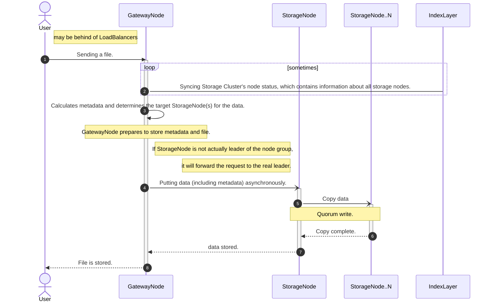
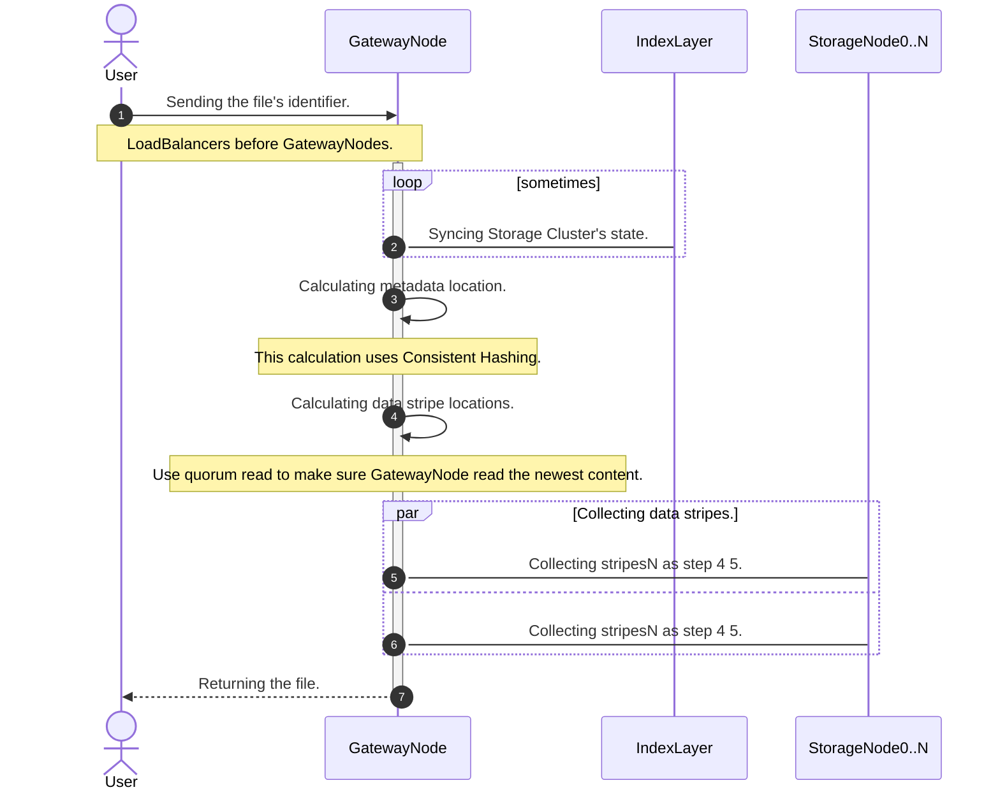
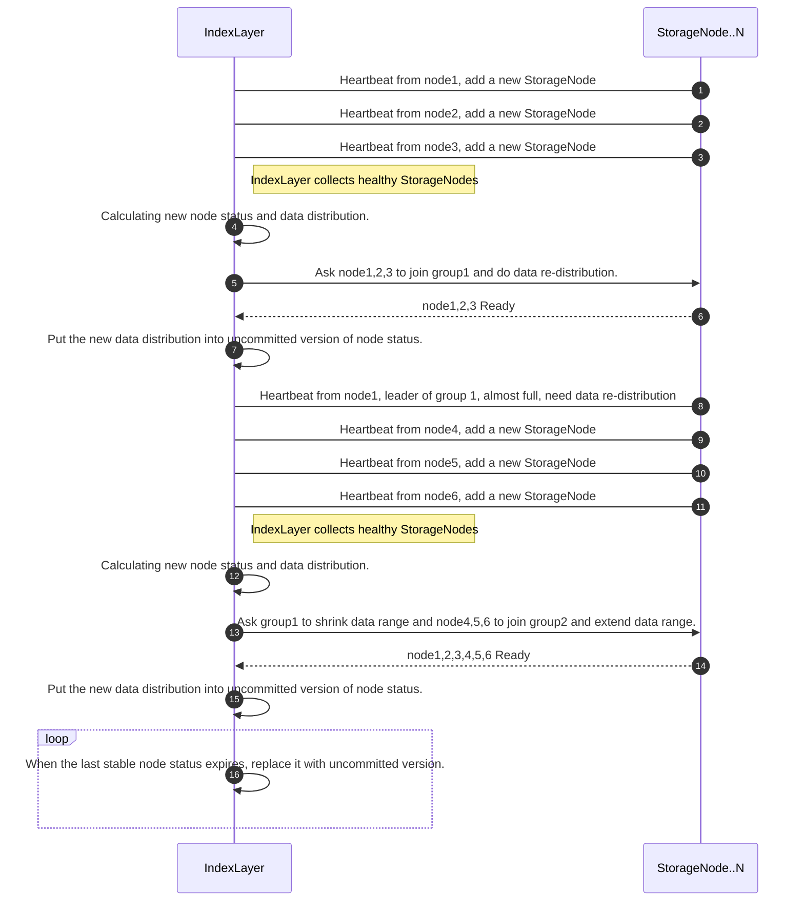

# HADSS
HADSS is short for High Availability Distributed Storage System.

HADSS can be used as backend of a Object Storage Service.

## Design Philosophy
HADSS is designed with high availability as a core principle:
*   **No Single Point of Failure:** The system is architected to tolerate failures of individual components.
*   **Responsive Scaling:** HADSS remains responsive even when the cluster scales up or down.

HADSS can answer basic requests even when the entire Index Layer is down.

## Architecture
HADSS consists of 3 layers:
- Gateway Layer
- Index Layer
- Storage Layer

Each Layer contain nodes in different regions, data centers or racks.

### Gateway Layer
Gateway Layer faces users' requests.

Gateway Layer wraps different kinds of storage services into RPCs to the Storage Layer and Index Layer.
e.g. The business logic for an Object Storage Service is usually on Gateway Layer.

The best practice in production is to place **Load Balancers** before Gateway Nodes.

### Index Layer
Index Layer monitors Storage Layer status and performs recovery. e.g.
- Monitor Storage Node cluster scaling (up or down)
- Monitor health of Storage Nodes
- Provide Storage Nodes' information to other layers
- Detect and recover data corruptions (Hard disk sometimes corrupts files)
- Detect and recover Node Failures
In the current implementation, the `Monitor` component handles the primary responsibilities of the Index Layer.

### Storage Layer
Storage Layer stores. It receives (Handler, ConsistencyPolicy, NodeStatusVersion (to be implemented)]) to store a file.
It can auto-balancing the storage usage between storage nodes by node status.

## How it works
The System's sequence diagram when storing a file by Object Storage Gateway.

The System's sequence diagram when fetching a file by Object Storage Gateway.

The System's sequence diagram when clusters scale up/down.

**Data Distribution and Re-balancing:**
The scaling of Storage Node clusters (adding or removing nodes) itself is less critical than the subsequent data re-balancing. If adding or removing nodes doesn't trigger a change in data distribution, the immediate impact is minimal. However, data re-balancing, which redistributes data across the available nodes, is a crucial process that directly affects data placement and availability.

## Testing
### E2E test
Execute `run.sh` to test run the whole system.

### Integration test
StorageConnector has Integration tests in `connector_test.go` to verify the interface implementation correctness.

### Unit test
StorageConnector has unit tests in `connector_test.go` to verify the right behaviour.

## Future Work

HADSS is an evolving system. Here are some areas planned for future development:

*   **NodeStatusVersion Implementation:** Complete the implementation of `NodeStatusVersion` in the Storage Layer to provide more granular control and consistency.
*   **Advanced Data Integrity:** Enhance mechanisms for detecting and recovering from data corruption, potentially including checksum validation and automated repair processes.
*   **Enhanced Index Layer Capabilities:** Further develop the Index Layer/Monitor component to provide more sophisticated cluster management and recovery features.
*   **Security Enhancements:** Implement robust authentication, authorization, and data encryption mechanisms.
*   **Broader Protocol Support:** Extend Gateway Layer to support a wider range of storage protocols.
